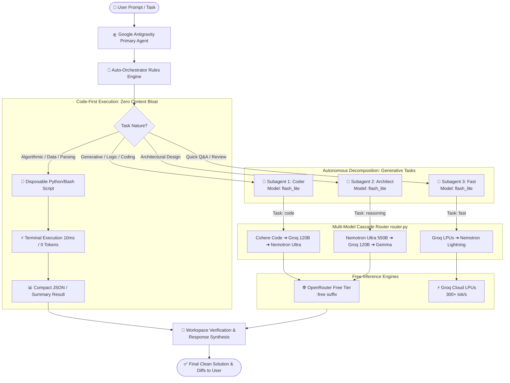

<div align="center">

# 🚀 AntiGravity-FreeModel

### **Autonomous Subagent Orchestrator, Code-First Deterministic Offloading, Universal Command Timeout Guard & Free Model Cascade for Google Antigravity (AGY)**

[](https://github.com/programmer-1998/AntiGravity-FreeModel)
[](LICENSE)
[](https://python.org)
[](https://gemini.google.com)
[-success.svg?style=for-the-badge)](https://openrouter.ai)
[](https://groq.com)
[](https://openrouter.ai)
[](https://github.com/programmer-1998/AntiGravity-FreeModel/pulls)

<p align="center">
  <b>Eliminate token anxiety, context bloat, and hanging terminal processes in Antigravity.</b><br>
  Execute instead of reading with <b>Code-First Deterministic Offloading</b>, guard terminal commands with <b>Universal Timeout & Execution Watchdog</b>, and seamlessly route code generation, debugging, and deep reasoning to top-tier free external models (<b>Groq LPUs</b>, <b>NVIDIA Nemotron Ultra 550B</b>, <b>Cohere Code</b>, and <b>Gemma 4</b>) while letting Gemini coordinate in lightweight mode.
</p>

[Key Features](#-key-features) • [Code-First Offloading](#-code-first-deterministic-offloading-v110-killer-feature) • [Timeout Watchdog](#-universal-command-timeout--execution-watchdog-v120) • [Architecture](#-architecture--how-it-works) • [Model Hierarchy](#-model-hierarchy--comparison) • [Installation](#-installation-guide) • [Free API Keys](#-obtaining-free-api-keys) • [CLI Usage](#-cli--script-reference) • [راهنمای فارسی](#-راهنمای-جامع-فارسی-persian-documentation)

---

</div>

## 💡 The Value Proposition

| Pain Point in Default Coding Assistants | How AntiGravity-FreeModel Solves It |
| :--- | :--- |
| **Context Window Bloat & Hallucination**: Dumping megabytes of raw logs, JSON schemas, CSVs, or entire file trees into LLM context wastes tens of thousands of tokens and degrades reasoning. | **Code-First Deterministic Offloading (v1.1.0)**: Executes disposable Python/Bash scripts locally. Computes filtering, math, regex, and parsing algorithmically with **ZERO context bloat** and 0 tokens. |
| **Hanging Terminal Tasks & Unbounded Freezes**: Scripts or background commands stalling indefinitely on I/O, network lags, or infinite loops freeze the agent and developer. | **Universal Execution Watchdog (v1.2.0)**: Automatically bounds every terminal execution with configurable timeout guards (`timeout 30s-60s`), diagnoses stalls (exit code 124), and proactively asks the user to extend timeout, kill, or pivot. |
| **Rapid Gemini Token Depletion**: Generating boilerplate, unit tests, and routine refactors drains daily rate limits and tokens. | **Zero-Token Burn**: 100% of heavy drafting, coding, and reasoning is offloaded to free external inference tiers. |
| **Latency Bottlenecks**: Waiting for large monolithic models on routine code generations slows down developer velocity. | **Blazing Groq LPUs**: Groq’s custom Language Processing Units deliver 250–400+ tokens/sec with sub-second response times. |
| **Monolithic Reasoning**: Single-context agents struggle with concurrent concerns (e.g. backend logic vs frontend styling). | **Autonomous Subagent Decomposition**: Automatically decomposes user requests into domain-specific subagents running in parallel. |
| **High Costs for Frontier Reasoning**: 500B+ frontier models usually cost substantial credits per million tokens. | **550B Nemotron for Free**: Access NVIDIA's massive 550B flagship model (`nemotron-3-ultra-550b-a55b:free`) with zero cost. |
| **Fragile Single-Provider APIs**: Rate-limit errors (429) interrupt ongoing coding workflows. | **Resilient Cascade Fallback**: Auto-cascades through backup free engines if the primary model encounters a quota hit or downtime. |

---

## ⚡ Key Features

- **⚡ Code-First Deterministic Offloading (v1.1.0 Killer Feature)**: Never ingest massive raw data, logs, or directory trees into the LLM context. Write and execute disposable Python/Bash scripts locally in milliseconds, letting the deterministic runtime compute answers with 0 tokens and feeding only the compact, structured summary back.
- **🛡️ Universal Command Timeout & Execution Watchdog (v1.2.0)**: Never let any terminal command or background task hang indefinitely. Enforces strict execution boundaries (`timeout 30s/60s`), detects stalls (exit code 124), provides instant root-cause analysis, and interactively offers users options to increase the timeout limit, kill the task, or adapt the approach.
- **💸 Zero Gemini Token Burn for Heavy Tasks**: Antigravity's primary Gemini agent stays in lightweight `flash_lite` coordinator mode, handling file I/O and user summaries while external models do the heavy lifting.
- **🤖 Autonomous Multi-Agent Decomposition**: Adheres to strict autonomous orchestration rules—complex prompts are cleanly decomposed into specialized subagents without requiring manual user intervention.
- **⚡ Blazing Groq LPUs**: Sub-second token delivery powered by Groq's custom LPU architecture running `openai/gpt-oss-120b` and `qwen/qwen3.8-27b`.
- **🧠 550B Flagship Reasoning**: NVIDIA Nemotron Ultra 550B handles system architecture, protocol design, complex algorithms, and deep logic analysis.
- **💻 Dedicated Coding Model**: Cohere North Mini Code (`cohere/north-mini-code:free`) provides specialized code synthesis, regex generation, refactoring, and lint fixing.
- **🔄 Smart Cascade & Failover Router**: Built-in 4-tier waterfall routing automatically falls back to secondary free models if a provider experiences temporary rate limits.
- **🔒 Zero Credential Leaks**: API keys are isolated in `config.env` or shell environment variables—no hardcoded credentials in the repository.

---

## 🚀 Code-First Deterministic Offloading (v1.1.0 Killer Feature)

> **"Never let an LLM do what 5 lines of Python or Bash can calculate deterministically in 10ms with zero token cost."**

### Why "Execute Instead of Reading"?

When developers ask an AI assistant to:
- *"Find all 500 errors in this 100MB server log"*
- *"Extract endpoints matching `/api/v2` from this 50,000-line OpenAPI JSON"*
- *"Count total functions without docstrings across 200 files"*
- *"Sum transaction totals from 10 CSV reports"*

Traditional AI assistants make the critical mistake of reading thousands of lines directly into the LLM context window. This causes:
1. **Context Window Saturation**: Thousands of valuable tokens burned in a single turn.
2. **Attention Degradation ("Lost in the Middle")**: LLMs lose precision when flooded with irrelevant raw text.
3. **Severe Latency & Cost**: Waiting for huge context payloads to upload and process.

### The Code-First Solution

AntiGravity-FreeModel enforces a **Code-First Execution** rule:

```
┌────────────────────────────────────────────────────────────────────────┐
│ ❌ TRADITIONAL APPROACH: Context Bloat (50,000+ Tokens)                │
│ Raw 50MB Log File ──> Read into LLM Context ──> LLM counts lines manually │
└────────────────────────────────────────────────────────────────────────┘

┌────────────────────────────────────────────────────────────────────────┐
│ ✅ CODE-FIRST APPROACH (AntiGravity-FreeModel v1.1.0: ZERO Bloat)       │
│ Raw 50MB Log File ──> python3 -c "import re..." ──> {'500': 14} ──> LLM│
│ (Computation time: 15ms | Tokens consumed: ~15 tokens | Cost: $0.00)  │
└────────────────────────────────────────────────────────────────────────┘
```

### Real-World Offloading Patterns:

#### 1. Instant Log Analysis (Regex & Counter)
```bash
python3 -c "
import collections, re
with open('var/log/nginx/access.log') as f:
    errors = collections.Counter(re.findall(r'\" (5\d\d) ', f.read()))
print(dict(errors))
"
# Output to agent: {'500': 23, '502': 4}
```

#### 2. Deep Schema / Large JSON Extraction
```python
# Disposable script parses a 10MB schema and emits only the target routes:
import json
with open("openapi.json") as f:
    data = json.load(f)
routes = [p for p in data.get("paths", {}) if "/checkout" in p]
print(json.dumps(routes, indent=2))
```

#### 3. Codebase AST & Dependency Auditing
```bash
python3 -c "
import ast, glob
for path in glob.glob('src/**/*.py', recursive=True):
    with open(path) as f:
        tree = ast.parse(f.read())
        for node in ast.walk(tree):
            if isinstance(node, ast.FunctionDef) and not ast.get_docstring(node):
                print(f'{path}:{node.name}')
"
```

---

## 🛡️ Universal Command Timeout & Execution Watchdog (v1.2.0)

> **"Never let a terminal command hang indefinitely, stall in silence, or freeze agent workflows without explanation."**

### Why Command Timeout & Watchdog Guards Matter
When developers and autonomous agents execute tasks in the terminal (such as deterministic data filtering, build processes, package installations, or background test suites), unexpected hangs frequently occur:
1. **Interactive Prompt Blocks**: A tool waiting for unbuffered user stdin (e.g. `[y/N]` confirmation prompts).
2. **Network Bottlenecks**: Lingering HTTP downloads or unresponsive remote registries.
3. **Infinite Loops & Deadlocks**: Algorithmic flaws in scripts causing 100% CPU lock or lock contention.
4. **Silent Background Stalls**: Background tasks that stop producing output while the agent waits endlessly.

### The Watchdog Solution
AntiGravity-FreeModel enforces a universal watchdog policy across **all** terminal executions:

```text
┌────────────────────────────────────────────────────────────────────────┐
│ ❌ WITHOUT WATCHDOG: Command hangs forever ──> Agent freezes in limbo   │
└────────────────────────────────────────────────────────────────────────┘

┌────────────────────────────────────────────────────────────────────────┐
│ ✅ WITH UNIVERSAL WATCHDOG (v1.2.0): Bounded Execution & Smart Report  │
│ Command ──> timeout 30s/60s ──> Exceeded? (Exit Code 124)               │
│      │                                                                 │
│      ▼                                                                 │
│ Proactive Persian RTL Report & Interactive Decision:                   │
│ • "The command exceeded the 30s timeout limit."                       │
│ • Identified Cause: Stalled network download / heavy build             │
│ • Options: 1) Increase Timeout (e.g. 2m/5m)  2) Kill  3) Alternative   │
└────────────────────────────────────────────────────────────────────────┘
```

#### Safe Execution Patterns:
```bash
# Standard command with bounded 30s execution:
timeout 30s python3 process_data.py

# Resilient pipeline with SIGKILL backup:
timeout --kill-after=5s 60s npm test
```

When a task exceeds its threshold or exits with code `124`:
- The agent **never** retries in a blind infinite loop.
- It immediately analyzes the root cause and reports the situation clearly to the user.
- It proactively offers interactive choices: **increase the timeout duration**, **kill/cancel the task**, or **switch to an alternative approach**.

---

## 🏗️ Architecture & How It Works

### High-Level Workflow



### ASCII Architecture Diagram

```text
                        ┌─────────────────────────────────┐
                        │     User Coding / AI Prompt     │
                        └────────────────┬────────────────┘
                                         │
                                         ▼
                        ┌─────────────────────────────────┐
                        │   Task Classifier & Decomposer  │
                        │     (Auto-Orchestrator Rule)    │
                        └────────┬───────────────┬────────┘
                                 │               │
        [Algorithmic / Parsing]  │               │  [Generative / Reasoning]
                                 ▼               ▼
        ┌────────────────────────────────┐     ┌─────────────────────────────────┐
        │  Code-First Offloading Engine  │     │   Autonomous Subagent Cascade   │
        │  • Disposable Python/Bash      │     │   • Coder (flash_lite)          │
        │  • Deterministic Terminal Exec │     │   • Architect (flash_lite)      │
        └───────────────┬────────────────┘     └───────────────┬─────────────────┘
                        │                                      │
                        ▼                                      ▼
        ┌────────────────────────────────┐     ┌─────────────────────────────────┐
        │   Zero-Token Compact Summary   │     │ Cohere Code / Groq / Nemotron   │
        │   (0 context bloat, 10ms)      │     │ (100% Free Inference Tier)      │
        └───────────────┬────────────────┘     └───────────────┬─────────────────┘
                        │                                      │
                        └────────────────┬─────────────────────┘
                                         │
                                         ▼
                        ┌─────────────────────────────────┐
                        │  Workspace Diffs & Verification │
                        │    Synthesized Final Response   │
                        └─────────────────────────────────┘
```

---

## 📊 Model Hierarchy & Comparison

The router classifies tasks into specialized domains and applies an optimal cascade order:

| Task Type (`-t`) | Primary Model | 1st Fallback | 2nd Fallback | Ideal Use Case |
| :--- | :--- | :--- | :--- | :--- |
| **`code`** | `cohere/north-mini-code:free` | `openai/gpt-oss-120b` (Groq) | `nvidia/nemotron-3-ultra:free` | Writing functions, bug fixing, refactoring, SQL, Regex |
| **`reasoning`** | `nvidia/nemotron-3-ultra:free` | `openai/gpt-oss-120b` (Groq) | `nvidia/nemotron-3.5:free` | Architectural design, math, logic evaluation, schema planning |
| **`fast`** | `openai/gpt-oss-120b` (Groq) | `nvidia/nemotron-3.5:free` | `cohere/north-mini-code:free` | Quick translations, regex parsing, CLI command syntax |
| **`general`** | `openai/gpt-oss-120b` (Groq) | `nvidia/nemotron-3-ultra:free` | `google/gemma-4-31b-it:free` | Summaries, documentation, general explanations |

### Comprehensive Free Model Matrix

| Model Alias | Upstream Model ID | Provider | Parameters | Speed / Latency | Key Strengths |
| :--- | :--- | :--- | :---: | :---: | :--- |
| **`groq`** | `openai/gpt-oss-120b` | Groq LPU | 120B | ⚡ Ultra-fast (~300 T/s) | High-speed logic, drafting, scripting |
| **`groq-qwen`** | `qwen/qwen3.8-27b` | Groq LPU | 27B | ⚡ Blazing (~400 T/s) | Fast multi-language coding & explanations |
| **`nemotron-ultra`** | `nvidia/nemotron-3-ultra-550b-a55b:free` | OpenRouter | 550B | 🧠 Deep (~25-50 T/s) | Deepest reasoning, system architectures, math |
| **`cohere`** | `cohere/north-mini-code:free` | OpenRouter | Specialized | 💻 Fast (~60-90 T/s) | Clean code synthesis, test suites, refactoring |
| **`nemotron`** | `nvidia/nemotron-3.5-lightning:free` | OpenRouter | High | ⚡ Fast (~100 T/s) | Multi-turn reasoning, structured outputs |
| **`gemma`** | `google/gemma-4-31b-it:free` | OpenRouter | 31B | 🌐 Balanced (~70 T/s) | General knowledge, translations, docs |
| **`laguna`** | `poolside/laguna-s-2.1:free` | OpenRouter | Specialized | 💻 Agile (~80 T/s) | Code generation and algorithmic tasks |

---

## 📥 Installation Guide

### Method 1: One-Line Automatic Install (Recommended)

Run this one-line command in your terminal:

```bash
git clone https://github.com/programmer-1998/AntiGravity-FreeModel.git ~/.gemini/config/plugins/auto-orchestrator && cd ~/.gemini/config/plugins/auto-orchestrator && ./install.sh
```

The installer will:
1. Validate that Python 3 is installed.
2. Ensure `router.py` has executable permissions.
3. Link the repository into `~/.gemini/config/plugins/auto-orchestrator`.
4. Create a clean `config.env` from `config.env.example`.

### Method 2: Manual Step-by-Step Setup

1. **Clone the repository**:
   ```bash
   git clone https://github.com/programmer-1998/AntiGravity-FreeModel.git ~/AntiGravity-FreeModel
   ```

2. **Run the installer script with your preferred mode**:
   ```bash
   cd ~/AntiGravity-FreeModel
   
   # For a live symlink (recommended for updates):
   ./install.sh --symlink
   
   # Or for an isolated copy:
   ./install.sh --copy
   ```

3. **Configure your API keys**:
   ```bash
   cp config.env.example config.env
   nano config.env  # or code config.env
   ```

4. **Verify the installation**:
   ```bash
   ~/.gemini/config/plugins/auto-orchestrator/skills/auto-orchestrator/scripts/router.py -t fast "Hello from AntiGravity-FreeModel"
   ```

---

## 🔑 Obtaining Free API Keys

Both providers offer free tiers that require **no credit card** or initial payment.

### 1. Groq Cloud API Key (Blazing Fast Inference)

1. Navigate to [console.groq.com/keys](https://console.groq.com/keys).
2. Sign in with GitHub or Google (takes 10 seconds).
3. Click **Create API Key**.
4. Give your key a name (e.g. `antigravity-groq`) and copy the generated key string starting with `gsk_...`.
5. Open your `config.env` and set:
   ```env
   GROQ_API_KEY=gsk_your_groq_api_key_here
   ```

> [!TIP]
> Groq's free tier provides generous rate limits (up to 30 requests/min and thousands of tokens/min), which is more than enough for continuous daily coding tasks.

---

### 2. OpenRouter API Key (550B Nemotron & Cohere Code)

1. Navigate to [openrouter.ai/settings/keys](https://openrouter.ai/settings/keys).
2. Sign up or log in with GitHub/Google.
3. Click **Create Key**.
4. Label the key (e.g. `antigravity-free`).
5. Copy the generated key starting with `sk-or-v1-...`.
6. Open your `config.env` and set:
   ```env
   OPENROUTER_API_KEY=sk-or-v1_your_openrouter_api_key_here
   ```

> [!NOTE]
> All models with the `:free` suffix on OpenRouter require **$0.00 account balance**. You never have to deposit credits to use them!

---

## 🛠️ Configuration Reference (`config.env`)

A sample configuration file is provided in [`config.env.example`](config.env.example):

```env
# ==============================================================================
# AntiGravity-FreeModel / Auto-Orchestrator Configuration
# ==============================================================================

# 1. Groq API Key (Ultra-fast LPU inference)
GROQ_API_KEY=gsk_your_groq_api_key_here

# 2. OpenRouter API Key (Free access to 550B Nemotron, Cohere Code, Gemma)
OPENROUTER_API_KEY=sk-or-v1-your_openrouter_api_key_here

# 3. Optional Paid Providers (Only used if specifically requested)
OPENAI_API_KEY=
ANTHROPIC_API_KEY=
```

### Config File Lookup Order

`router.py` automatically checks for credentials in the following order:
1. `CONFIG_ENV_PATH` environment variable (if set).
2. Current working directory: `./config.env`.
3. Plugin root: `~/.gemini/config/plugins/auto-orchestrator/config.env`.
4. Global config: `~/.gemini/config/config.env`.
5. Standard shell environment variables (`GROQ_API_KEY`, `OPENROUTER_API_KEY`).

---

## 💻 CLI & Script Reference

You and your subagents can invoke the router directly via the CLI:

```bash
# General syntax
python3 router.py [-t {code,reasoning,fast,general}] [-m MODEL_NAME] [-s SYSTEM_PROMPT] [-f FILE] "PROMPT"
```

### Command-Line Arguments

| Flag | Long Option | Description | Example |
| :--- | :--- | :--- | :--- |
| `-t` | `--type` | Task profile (`code`, `reasoning`, `fast`, `general`) | `-t code` |
| `-m` | `--model` | Force a specific model alias or OpenRouter model ID | `-m nemotron-ultra` |
| `-s` | `--system` | Provide a custom system prompt | `-s "Output only JSON"` |
| `-f` | `--file` | Read the prompt from a local file | `-f src/app.py` |

### Practical Examples

```bash
# 1. Generate code using the coding cascade (Cohere Code -> Groq -> Nemotron):
~/.gemini/config/plugins/auto-orchestrator/skills/auto-orchestrator/scripts/router.py \
  -t code "Write an asynchronous rate-limiter in Python using Redis and sliding-window algorithm"

# 2. Perform deep architectural analysis using Nemotron Ultra 550B:
~/.gemini/config/plugins/auto-orchestrator/skills/auto-orchestrator/scripts/router.py \
  -m nemotron-ultra "Compare Event Sourcing vs CQRS for high-frequency financial ledgers"

# 3. Blazing fast translation or explanation via Groq LPUs:
~/.gemini/config/plugins/auto-orchestrator/skills/auto-orchestrator/scripts/router.py \
  -t fast "Explain the difference between epoll, kqueue, and select in Linux"

# 4. Refactor a file directly:
~/.gemini/config/plugins/auto-orchestrator/skills/auto-orchestrator/scripts/router.py \
  -t code -f buggy_code.py "Refactor this code to follow Clean Architecture principles"
```

---

## 💬 In-Chat Antigravity Prompts

Once installed, the plugin rules are **always active** in the background. You can also explicitly trigger external models using natural language:

- **"این کد را با مدل آزاد بنویس"** ➔ Routes automatically through the free cascade.
- **"با گراک این باگ رو رفع کن"** ➔ Routes immediately to Groq LPU `openai/gpt-oss-120b`.
- **"از نموترون بپرس معماری دیتابیس رو طراحی کنه"** ➔ Invokes `nvidia/nemotron-3-ultra-550b-a55b:free`.
- **"کد اعتبارسنجی فرم‌ها رو با کوهیر بنویس"** ➔ Invokes `cohere/north-mini-code:free`.

---

## 📁 Repository Structure

```text
AntiGravity-FreeModel/
├── .gitignore                      # Ignores config.env, logs, python bytecode
├── config.env.example              # Key configuration template
├── install.sh                      # Automated installer script (symlink/copy)
├── LICENSE                         # MIT Open Source License
├── plugin.json                     # Antigravity plugin manifest (v1.2.0)
├── README.md                       # Comprehensive documentation
├── rules/
│   └── AGENTS.md                   # Strict autonomous subagent, offloading & token minimizer rules
└── skills/
    └── auto-orchestrator/
        ├── SKILL.md                # Orchestration skill definition & offloading workflows
        └── scripts/
            └── router.py           # Multi-model cascade router runner
```

---

<div dir="rtl">

## 🇮🇷 راهنمای جامع فارسی (Persian Documentation)

### مقدمه و هدف پروژه

پلاگین **AntiGravity-FreeModel** (موتور ارکستراتور خودکار ساب‌ایجنت‌ها، اجرای مستقیم کد و روتر مدل‌های آزاد) با هدف **به صفر رساندن مصرف توکن‌های گران‌قیمت جمنای**، **جلوگیری از اشباع حافظه (Context Bloat)** و **افزایش چشمگیر سرعت توسعه** در محیط **Google Antigravity (AGY)** طراحی شده است.

در نسخه **v1.2.0**، علاوه بر قابلیت **Code-First Deterministic Offloading** (اجرای مستقیم کد به جای خواندن فایل در حافظه مدل)، سیستم سراسری **Universal Command Timeout & Execution Watchdog** افزوده شده است تا هیچ دستور ترمینال یا تسک پس‌زمینه‌ای هرگز در حالت معلق (Hang) نماند و در صورت نیاز به زمان بیشتر، به صورت هوشمند و تعاملی از کاربر اجازه افزایش زمان دریافت شود.

---

### 🌟 مزایای کلیدی:

1. **قابلیت انقلابی Code-First Offloading (نسخه ۱.۱.۰)**: به جای ارسال ده‌ها هزار خط لاگ، اسناد حجیم JSON یا درخت فایل‌ها به حافظه کانتکست ایجنت، این تسک‌ها به اسکریپت‌های سبک پایتون و بش محول شده و تنها نتیجه خلاصه و دقیق به کانتکست بازگردانده می‌شود.
2. **نگهبان سراسری زمان اجرا (Watchdog - نسخه ۱.۲.۰)**: اعمال سقف زمانی ایمن بر روی تمام دستورات ترمینال، تشخیص خودکار اتمام مهلت (کد ۱۲۴)، تحلیل علت توقف، و پرسش تعاملی از کاربر برای افزایش تایم‌اوت، متوقف کردن پروسه یا تغییر رویکرد.
3. **مصرف توکن جمنای نزدیک به صفر**: مدل جمنای صرفاً در نقش سبک (`flash_lite`) به عنوان هماهنگ‌کننده و مدیر فایل‌ها فعالیت کرده و توکن‌های سنگین را حفظ می‌کند.
4. **سرعت خارق‌العاده با پردازنده‌های Groq LPU**: تحویل ۳۰۰ تا ۴۰۰ توکن در ثانیه با تأخیر کمتر از ۱ ثانیه به کمک چیپ‌های اختصاصی Groq.
5. **بهره‌مندی رایگان از مدل ۵۵۰ میلیاردی Nemotron Ultra**: دسترسی آزاد به پرچمدار غول‌پیکر شرکت انویدیا برای پیچیده‌ترین مسائل معماری سیستم، الگوریتم‌ها و استدلال‌های عمیق.
6. **مدل تخصصی برنامه‌نویسی Cohere North Mini Code**: بهینه‌سازی شده برای سنتز سریع کدهای پایتون، جاوااسکریپت، تایپ‌اسکریپت، گو، راست، دیباگ و تولید عبارات منظم.
7. **معماری فال‌بک خودکار (Cascade Failover)**: در صورت بروز خطای محدودیت نرخ (Rate-limit) در یک سرویس‌دهنده، روتر بلافاصله و بدون وقفه به مدل رایگان بعدی سوئیچ می‌کند.
8. **امنیت کامل کلیدها**: کلیدهای محرمانه شما به هیچ عنوان وارد مخزن گیت نشده و صرفاً در فایل محلی `config.env` نگهداری می‌شوند.

---

### 💡 استراتژی Code-First: چرا اجرا به جای خواندن؟

هنگامی که از هوش مصنوعی می‌خواهید لاگ‌های خطای سرور را تحلیل کند یا فیلدهای خاصی را از یک JSON ده‌مگابایتی استخراج نماید، رویکرد سنتی تمام فایل را درون پنجره کانتکست بارگذاری می‌کند. این کار سبب:
- سوختن ده‌ها هزار توکن باارزش در یک پیام؛
- افت تمرکز مدل و بروز توهم (Hallucination) به دلیل شلوغی کانتکست؛
- و افزایش زمان انتظار می‌شود.

در **AntiGravity-FreeModel**، ایجنت به صورت خودکار یک خط کد پایتون یا بش تولید کرده، آن را در چند میلی‌ثانیه در ترمینال اجرا نموده و تنها خروجی خلاصه و مشخص (مثلاً `{'500': 14}`) را وارد کانتکست می‌کند. نتیجه: **مصرف صفر توکن برای پردازش داده‌های خام و سرعت فوق‌العاده**.

---

### 🛡️ مکانیزم سراسری نگهبان زمان و تایم‌اوت ترمینال (Universal Watchdog - v1.2.0)

یکی از چالش‌های بزرگ در اجرای دستورات ترمینال و اسکریپت‌های تحلیلی، **گیر کردن فرآیندها (Hanging / Stalling Processes)** به دلایلی نظیر انتظار برای ورودی کاربر (`stdin` یا تاییدهای `[y/N]`)، کندی یا قطعی شبکه و دانلود، کامپایل‌های سنگین و طولانی، یا حلقه‌های نامتناهی در اسکریپت‌ها است.

در نسخه **v1.2.0**، رفتار هوشمند زیر به عنوان یک قاعده سراسری پیاده‌سازی شده است:
- **پوشش محافظتی زمانی (Timeout Guard)**: تمام دستورات ترمینال به صورت پیش‌فرض با محدودیت زمانی مشخص (مثلاً ۳۰ تا ۶۰ ثانیه) اجرا می‌شوند تا فرآیند و ایجنت هرگز معلق نمانند.
- **تشخیص هوشمند کد خروج ۱۲۴**: در صورتی که زمان یک دستور به اتمام برسد، ابزار با کد ۱۲۴ متوقف شده و ایجنت فوراً علت احتمالی را بررسی و کشف می‌کند.
- **گزارش شفاف به کاربر و پرسش تعاملی**: ایجنت به جای گیر کردن یا تلاش بیهوده در حلقه تکرار، وضعیت را به فارسی روان و شفاف گزارش می‌دهد؛ به کاربر اعلام می‌کند چه دستوری در حال اجرا بود و به چه دلیلی به سقف زمانی رسید، و سپس گزینه‌های زیر را پیشنهاد می‌دهد:
  1. افزایش سقف تایم‌اوت (مثلاً ۲ یا ۵ دقیقه) و اجرای مجدد.
  2. متوقف ساختن فرآیند معلق (Kill Task).
  3. استفاده از یک شیوه جایگزین یا قطعه‌بندی شده (Chunked).

---

### 🚀 راهنمای گام به گام نصب و راه‌اندازی

#### روش اول: نصب سریع با یک دستور (پیشنهادی)

ترمینال لینوکس یا مک را باز کرده و دستور زیر را اجرا کنید:

```bash
git clone https://github.com/programmer-1998/AntiGravity-FreeModel.git ~/.gemini/config/plugins/auto-orchestrator && cd ~/.gemini/config/plugins/auto-orchestrator && ./install.sh
```

#### روش دوم: راه‌اندازی دستی

```bash
# ۱. کلون کردن مخزن
git clone https://github.com/programmer-1998/AntiGravity-FreeModel.git ~/AntiGravity-FreeModel
cd ~/AntiGravity-FreeModel

# ۲. اجرای اسکریپت نصب
./install.sh --symlink

# ۳. آماده‌سازی فایل تنظیمات کلیدها
cp config.env.example config.env
nano config.env
```

---

### 🔑 نحوه دریافت کلیدهای رایگان API (بدون نیاز به کارت اعتباری)

#### ۱. ثبت‌نام در گراک کلود (Groq Cloud)
- به نشانی `https://console.groq.com/keys` بروید.
- با حساب گیت‌هاب یا گوگل خود به سادگی وارد شوید.
- بر روی دکمه **Create API Key** کلیک کرده و رشته کلید را کپی کنید.
- مقدار کلید را در فایل `config.env` قرار دهید:
  ```env
  GROQ_API_KEY=gsk_your_groq_key
  ```

#### ۲. ثبت‌نام در اپن‌روتر (OpenRouter)
- به نشانی `https://openrouter.ai/settings/keys` مراجعه فرمایید.
- وارد حساب کاربری خود شده و روی دکمه **Create Key** کلیک کنید.
- رشته کلید ایجاد شده را کپی کرده و در `config.env` درج نمایید:
  ```env
  OPENROUTER_API_KEY=sk-or-v1-your_openrouter_key
  ```
- *توجه: استفاده از مدل‌های دارای پسوند `:free` در OpenRouter نیاز به هیچ‌گونه موجودی یا شارژ مالی ندارد.*

---

### 💡 نمونه دستورات اجرایی مستقیم در ترمینال

```bash
# تولید کد با زنجیره کوهیر و گراک:
~/.gemini/config/plugins/auto-orchestrator/skills/auto-orchestrator/scripts/router.py -t code "Write a full JWT Auth controller in FastAPI"

# طراحی معماری میکروسرویس با مدل ۵۵۰ میلیاردی نموترون:
~/.gemini/config/plugins/auto-orchestrator/skills/auto-orchestrator/scripts/router.py -m nemotron-ultra "Design an event-driven architecture for e-commerce"

# پاسخ‌های سریع و آنی با گراک ۱۲۰ میلیاردی:
~/.gemini/config/plugins/auto-orchestrator/skills/auto-orchestrator/scripts/router.py -t fast "Explain CORS in simple terms"
```

</div>

---

## 🗺️ Roadmap & Future Enhancements

- [x] **v1.0.0**: Initial release featuring Groq LPUs, OpenRouter Free models, automatic cascade fallback, and autonomous subagent decomposition.
- [x] **v1.1.0**: **Code-First Deterministic Offloading & Computational Scripting** (Execute Instead of Reading, Zero Context Bloat).
- [x] **v1.2.0**: **Universal Command Timeout Guard & Execution Watchdog** (Bounded Terminal Execution, Exit Code 124 Detection, Interactive Timeout Adjustment).
- [ ] **v1.3.0**: Integration of DeepSeek-V3 & DeepSeek-R1 free community endpoints.
- [ ] **v1.4.0**: Local Ollama & vLLM zero-latency fallback integration for offline environments.
- [ ] **v1.5.0**: Dynamic response caching layer with SQLite/Redis to avoid duplicate queries.
- [ ] **v1.6.0**: Interactive visual metrics sidecar displaying token savings and latency statistics inside Antigravity.

---

## 🤝 Contributing

We welcome contributions from developers worldwide!
- Fork the repository.
- Create your feature branch (`git checkout -b feature/amazing-feature`).
- Commit your changes (`git commit -m 'Add some amazing feature'`).
- Push to the branch (`git push origin feature/amazing-feature`).
- Open a Pull Request.

## 👨‍💻 Author & Contact

Developed with passion by **Sina Khanzadeh**.

<p align="center">
  <a href="https://sina-khanzadeh.ir"></a>
  <a href="mailto:khanzadeh.1377@gmail.com"></a>
  <a href="https://t.me/programmer_1998"></a>
  <a href="https://instagram.com/programmer_1998"></a>
  <a href="https://discord.com/users/@programmer_1998"></a>
  <a href="https://github.com/programmer-1998"></a>
</p>

| Channel | Contact Info |
| :--- | :--- |
| **🌐 Website** | [sina-khanzadeh.ir](https://sina-khanzadeh.ir) |
| **📧 Email** | [khanzadeh.1377@gmail.com](mailto:khanzadeh.1377@gmail.com) |
| **✈️ Telegram** | [@programmer_1998](https://t.me/programmer_1998) |
| **📸 Instagram** | [@programmer_1998](https://instagram.com/programmer_1998) |
| **💬 Discord** | `@programmer_1998` |
| **🐙 GitHub** | [@programmer-1998](https://github.com/programmer-1998) |

<div dir="rtl">

### ارتباط با سازنده و توسعه‌دهنده
این پروژه با افتخار توسط **سینا خان‌زاده (Sina Khanzadeh)** طراحی و توسعه داده شده است.  
برای برقراری ارتباط، مشاوره، ارسال پیشنهادات، همکاری در پروژه‌ها یا گزارش باگ‌ها می‌توانید از طریق راه‌های ارتباطی فوق یا وب‌سایت شخصی [sina-khanzadeh.ir](https://sina-khanzadeh.ir) اقدام فرمایید.

</div>

---

## 📄 License

Distributed under the **MIT License**. See [`LICENSE`](LICENSE) for more information.

<div align="center">

**Built with ❤️ for the Google Antigravity & AI Developer Community**

[⭐ Star this repository](https://github.com/programmer-1998/AntiGravity-FreeModel) • [Report a Bug](https://github.com/programmer-1998/AntiGravity-FreeModel/issues) • [Request a Feature](https://github.com/programmer-1998/AntiGravity-FreeModel/issues)

</div>
